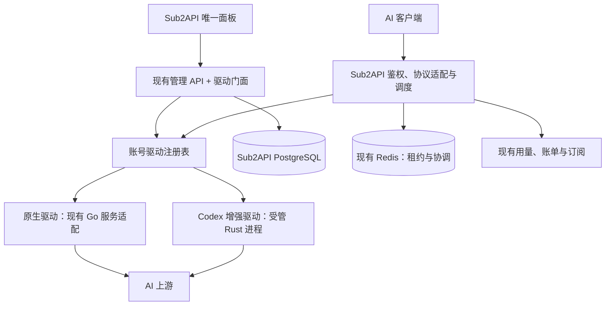

# 统一账号管理与驱动架构

## 1. 基线与已确认扩展点

本方案依据 Sub2API `3a6fd1c9d` 与 CPR `d875a626`（v3.22.1）源码。它是目标设计，不表示这些接口已存在。

实施更新：首个可用 preset 已选择“原生生命周期 + Codex HTTP/SSE、WS transport”。账号绑定首先用 `accounts.account_driver_id/account_driver_revision` 两列原子保存；因为当前一个账号只有一个固定 preset，尚无可编辑 driver settings，暂不建独立绑定表。未来需要组件组合、私有设置或维护切换时再演进绑定模型。全局 credential revision 与 CPR 独立生命周期仍是后续目标，当前模块只获取宿主当次 AT，不拥有第二套刷新任务。当前 WS 用完整 Authorization 摘要、账号、绑定、用户范围和进程代次隔离，RPC credential_revision 固定为 0，不将此快照称为全局 CAS。实际状态见 implementation-status.md。

| 当前入口 | 已有能力 | 设计使用方式 |
| --- | --- | --- |
| `backend/ent/schema/account.go` | 账号、凭据、分组、代理、调度状态、并发和倍率 | 保留统一账号实体，新增独立运行绑定 |
| `backend/internal/service/platform_catalog.go` | 平台与多协议接入清单 | 在管理方式维度叠加驱动能力，不重定义平台 |
| `backend/internal/service/oauth_refresh_api.go` | 请求与后台共用 OAuth 刷新 API | 宿主持有刷新调度、锁与持久化，按绑定调用驱动 |
| `backend/internal/service/openai_plugin_transport.go` | OAuth 请求与账号测试的插件转发 | 首个执行扩展点，新增绑定不会嵌套调用两套驱动 |
| `backend/internal/service/plugin_manager.go` | 包、安装、配置、运行状态与 HTTP 路由 | 扩展为能力注册与明确绑定，保留旧合同 |
| `backend/pkg/pluginapi/v1/plugin.proto` | HTTP 转发、KV、账号目录与出站身份 | HTTP v1 可兼容，完整生命周期与 WS 需要新增能力 |
| `frontend/src/components/account/` | 创建、编辑、授权、导入、测试和额度组件 | 抽出管理方式与能力表单片段，复用共同操作 |
| `frontend/src/views/admin/AccountsView.vue` | 统一账号列表、批量操作与用量 | 增加管理方式筛选、显示及能力化操作 |

现有 v1 插件命中的 WebSocket 入口会走 HTTP Bridge。它适合 HTTP/SSE transport 扩展，不能据此宣称已经拥有 CPR 原生 WebSocket 会话能力。

## 2. 总体结构与职责



| 事实或策略 | 唯一负责方 |
| --- | --- |
| 用户、客户端 Key、余额、订阅、支付与下游授权 | Sub2API |
| 账号 ID、凭据持久化、分组、代理、模型政策与运行绑定 | Sub2API |
| 选号、账号轮换、并发、限速、用户和账号用量、最终扣费 | Sub2API |
| OAuth/Token 协议、凭据规范化、上游额度与身份解析 | 账号绑定的生命周期驱动 |
| 请求协议、网络传输、上游 WS 连接与响应解析 | 账号绑定的执行驱动 |
| 刷新任务触发、互斥、结果版本核验及提交 | Sub2API；驱动只执行一次刷新操作 |
| 一次请求能否换号、是否已提交响应、重试总预算 | Sub2API；驱动报告事实，不能自行轮换 |
| 执行连接句柄、连接内续接与临时缓冲 | 驱动运行进程，宿主保存关联与失效事实 |

Rust 驱动不需要独立 PostgreSQL、Redis、Web 管理端或 Client Key。它作为宿主的内部执行模块部署，可是子进程，也可在需要进程隔离时作为受管容器；通信使用账号绑定与单次操作合同，不是 OpenAI Base URL 桥接。

## 3. 面板体验：三个独立维度

新增账号沿用现有页面，增加管理方式选择：

```text
平台           OpenAI / Anthropic / Gemini / …
管理方式       原生管理 / Codex 增强管理
接入方式       OAuth 授权 / Token 导入 / API Key / 支持的批量导入
账号设置       名称、分组、代理、并发、优先级、倍率、模型权限
高级设置       HTTP / WebSocket 优先 / 客户端画像 / 支持的增强选项
```

平台不是驱动；OAuth 不是管理引擎；账号管理方式也不是下游接口协议。后端返回有效组合和能力，前端只展示它们。原生驱动保留已有平台与接入方法；增强驱动最初只开放通过验收的 OpenAI/Codex 组合，不能推断已支持所有平台。

列表显示管理方式、运行状态、当前版本及额度。授权、重新授权、刷新、测试、导出、停用、分组和用量都在同一套面板完成。共同表单使用原有组件；驱动专属字段以声明式 schema 与少量类型化组件提供，复杂专属诊断可以复用插件页，但日常账号管理不依赖第二套 iframe 面板。

系统设置中的“默认管理方式”只影响新账号的初始值。既有账号的绑定是显式事实，不随默认值或驱动升级被自动切换。

## 4. 账号、绑定与能力模型

保留 `accounts` 和现有认证字段，不新增一张 CPR 账号表。新增 `account_driver_bindings`，与账号一对一，建议字段：

```text
account_id                账号外键与唯一键
driver_instance_id        对应受管驱动实例
preset_id                 已验收的生命周期 + 执行组合
binding_revision          切换和设置更新的并发条件
settings                  非凭据的账号专属设置
settings_schema_version   驱动负责的设置结构版本
```

无绑定等于既有原生行为；初期不批量重写旧账号。账号表另新增 `credential_revision`，这是新设计字段：所有凭据写入路径均需在实际变更时原子推进，不能把 CPR 的同名能力假定为 Sub2API 已具备。凭据 revision 与绑定 revision 分开，刷新不重写管理方式。

标准账号信息与驱动私有凭据结构通过 `CredentialEnvelope` 表达：`schema_id`、`schema_version`、payload。以兼容迁移保持原生现有凭据读法；驱动命名空间与 settings 中不持久化第二份 Token。现有凭据存储保护如需增强，应由独立、覆盖备份恢复的存储变更实现，不能仅凭 envelope 名称宣称加密。

生命周期驱动与执行驱动在实现上分离，面板以已验证 preset 呈现“管理方式”，避免开放任意组合。比如增强 transport 仍复用原生 OAuth 时，preset 必须明确声明此归属，不在故障时临时降级。目标 CPR preset 完成自身授权、导入、刷新、额度与执行适配后才可作为完整增强管理方式发布。

能力查询建议新增：`GET /api/v1/admin/account-drivers`。每项包含 ID、版本、状态、平台/认证范围、preset、接入方法、操作与协议支持、设置 schema。能力按配置与健康状态复核，不依据名称或前端常量猜测。

## 5. 两类合同，共用一个驱动门面

逻辑接口草案如下；最终 wire 用现有 SDK 的新增服务与版本化能力表达，不再建设第二个独立插件管理框架。

```text
LifecycleDriver
  Capabilities
  BeginAuthorization / CompleteAuthorization
  NormalizeImport / ValidateCredentials
  RefreshCredential
  QueryQuota / QueryProfile / QueryModels
  Probe

ExecutionDriver
  PrepareAttempt
  ExecuteAttempt (双向流)
  CancelAttempt
  DrainAccount / ReleaseSession
```

不是所有驱动都实现全部操作。API Key 的刷新可返回“不适用”，不能伪装成功。原有管理员操作保持现有路由与权限，由内部门面分派；新增 binding 与 capability 接口仅覆盖新的事实。

`PrepareAttempt` 不发送该次推理业务请求。输入绑定宿主已选定的 `account_id`、credential/binding revision、运行代次、请求/attempt ID、用户/Key 会话作用域、模型、代理、超时与原始 wire。执行不可枚举并改选其他账号，不使用插件 KV 保存第二份权威账号池。

执行通常只获得 access token；只有声明并授权相应能力的生命周期操作能获得刷新或导入所需材料。宿主以真实管理员/系统任务与账号绑定限定每次调用，驱动不能通过任意 account_id 读取其他账号凭据。宿主回调必须复核调用身份、绑定版本和取消状态。受管 RPC 不开放公共业务端口；本机或容器通信需提供连接身份验证，不能把“内网地址”本身当作访问授权。

执行输出分别承载：

- 原始响应状态、headers 与业务 wire，保持未知字段、多值 header、事件顺序
- `send_state`：`not_sent / sent / ambiguous`，连接中断后未知状态按 ambiguous 处理
- 上游错误分类、限流与额度观测，以及有依据的安全重放提示
- 标准化 usage、实际模型、服务档位与上游关联 ID
- 续接约束：账号、连接、凭据版本、驱动代次与是否需要客户端完整重放

usage 观测具有 request、attempt、sequence、final 标识，宿主去重并接入现有结果与计费口径。驱动不扣余额、不写账本。下游计费按现有成功/失败口径保持；首次引入多 attempt 已消费费用时，先保存成本事实并明确与用户扣费的区别，不能仅为了兼容 CPR 改变现有用户收费规则。

现有 HTTP transport v1 使用保守适配：`request_sent=false` 必须可证明未发送；true 在无法确认细节时映射为 ambiguous。完整 WS 消息、取消与发送事件使用新能力；旧服务保持兼容，不能往旧合同塞入未经协商的 WS 语义。

## 6. 凭据操作、刷新与切换

授权流程由宿主接收管理员身份、保存一次性流程 ID 与有效期，绑定驱动实例/preset；驱动处理 PKCE/state 与上游交换，完成后通过宿主事务写入账号及凭据。完成前核验流程归属、版本和一次性 claim，失败不创建半个可调度账号。

导入采用“解析预览 → 校验 → 确认提交”，匹配已有账号时不覆盖未明确选择的分组、优先级或管理方式。只接受目标驱动支持的凭据格式；不能用未验证的邮箱认定两个账号相同。

后台刷新与请求侧刷新统一进入既有 `OAuthRefreshAPI`。锁按账号身份隔离，而不是按引擎分别建立；宿主读取当前绑定与凭据版本，调用相应 executor，事务比较后提交新凭据，失效 Token/目录缓存及发布调度变更。Rust 不再启动 CPR 的独立 refresh worker。必须覆盖所有凭据入口：创建、编辑、导入、重新授权、批量更新、后台刷新、请求刷新、恢复与影子账号主凭据关联。

切换采用异步、有审计的维护操作：

1. 保存带 `expected_binding_revision` 的切换意图并阻止新的该账号准入，先复核宿主账号设置
2. 排空在途推理、原生 WS 会话与刷新操作；等待期间对该账号的凭据修改和新刷新均拒绝或进入同一维护门
3. 取得账号刷新锁，再读取最终 credential revision；目标驱动校验并产生迁移结果，不发送测试推理或不可逆上游操作
4. 在事务中核验凭据、绑定、维护代次和权限，提交迁移后的凭据与新绑定；发布缓存失效及恢复准入
5. 失效旧连接句柄、旧续接/目录缓存；失败释放维护门并保留原绑定，禁止部分切换

允许处理中的费用结算完成，不在切换事务内等待网络。平台、认证结构不兼容时要求重新授权或拒绝切换，不能承诺所有账号“无损一键切换”。具备兼容声明且验证通过的 OpenAI OAuth 原生/增强组合可保留账号 ID、分组、费用与用量历史。

普通管理查询不推进凭据版本。进程重启、异常退出和切换任务中断都须恢复维护状态，避免永久暂停账号。默认保持单宿主增强部署，扩容前必须另外验证 WS owner 路由及跨进程会话；既有宿主扩容能力不自动传递给增强驱动。

## 7. 请求路由与原有功能继承

先由 Sub2API 做鉴权、分组/模型映射、用户预算和账号准入，再按选中账号冻结其绑定与驱动代次。协议转换由既有协议适配层集中承担，驱动边界接收选定平台的有效 wire；同一请求不得被原生与增强层重复规范化。CPR 专属 Codex 兼容由对应驱动拥有，并标注输入已完成哪些规范化。

宿主持有一次请求的重试预算、响应提交和账单责任。驱动不跨账号重试；允许的底层同连接恢复必须有合同定义、消耗宿主预算并报告各次发送事实，不能藏在 transport 内。一个 attempt 开始交付后，后续错误不切换驱动或账号。

原生续接必须同时匹配用户/Key 范围、账号、凭据版本、绑定和运行代次。使用宿主原始作用域标识，无需转换成共享 CPR Client Key。HTTP/SSE 与 WS 连接池分别按账号与版本隔离，模型目录按驱动、凭据与客户端画像隔离，公开目录仍接受宿主分组权限和映射过滤。

当前固定 preset 使用独立 `OpenWebSocket` 双向 RPC，每个 RPC 只持有一条物理上游连接。CPR prepared opening 只完成握手、TLS 与出站代理，Sub2API 原连接池拥有 response ID 和逐轮计费。握手成功仍为业务 `not_sent`；宿主在发送业务消息前记录可能已发送，Rust flush 成功后才确认 write ACK。Ping 另等相同 nonce 的 Pong。连接中断不在 driver 内重连，宿主也不会把可能已发送的请求或失去连接归属的增量续接自动重放为 HTTP。保留旧驱动 ID，新增 WS 能力由握手明确协商。

| 原有能力 | 继承方式 | 增强路径验收要点 |
| --- | --- | --- |
| 用户、API Key、订阅与支付 | 完全复用现有业务入口 | 普通与订阅账号扣费一致 |
| 分组、组合分组、模型映射和白名单 | 宿主在选号与公开目录统一裁决 | 同组原生/增强账号不扩大授权范围 |
| 代理、账号并发、优先级与倍率 | 仍使用同一账号字段和宿主租约 | 驱动收到生效代理，取消后释放容量 |
| Chat Completions | 复用现有转换入口或原生协议账号 | CPR 不原生支持该接口，需明确转换支持范围 |
| Responses HTTP/SSE | 新执行适配接入原结果链 | wire、usage、错误与未知字段保持 |
| Responses WS | 新的有状态执行能力 | 跨轮次认证、取消、续接和连接失效 |
| 图片、Search、compact 等 | 按端点分别声明能力 | 不能从 Responses 可用推断这些端点已支持 |
| 风控、审计、备份与日志 | 使用宿主既有入口，含新增绑定 | 恢复不启动缺失或不兼容驱动 |
| 影子账号等派生资源 | 沿用主账号凭据关联，冻结实际绑定 | 首期未验证时禁止增强组合，而不是隐式另存凭据 |

## 8. Rust 驱动边界与工程结构

优先保留 Rust 上游协议实现，避免逐次翻译为 Go。CPR 当前不是可直接引用的独立 transport SDK：Provider 与宿主 ports、账号选择、lease、session、worker 有关联。抽离需要维护适配层，不能只依赖整个 `provider-openai` crate 就假定绕过了其内部选号。

概念验证确定可复用的 credential、protocol、transport、catalog 子模块；宿主 adapter 注入一个固定候选、宿主租约和状态端口，禁用上游选号、持久化及后台任务。如果只能大规模模拟 CPR 的全套 Store/Core 才能运行，判定边界不合适，缩小首次复用范围。

目标工程组织：

```text
Sub2API 本仓库
  backend/internal/accountdriver/        合同、registry 与绑定解析
  backend/internal/service/             对现有入口的薄适配
  backend/pkg/pluginapi/                新能力 wire + v1 兼容
  frontend/src/features/account-drivers/选择、能力与专属表单
  tools/upstream/                       版本锁、差异检查与更新报告

独立 codex-account-driver 仓库（开发阶段可临时放本地独立目录）
  host-adapter/                         宿主协议、发送事实、usage 和会话映射
  upstream/                            固定 CPR 源码引用或受控 subtree
  compat/                              与选定上游版本相关的适配
  tests/                               宿主合同与协议 fixture 验证
  upstream-lock                        commit、模块范围、补丁与合同版本
```

这是逻辑边界，实施时优先复用现有命名与代码，不要求重排完整 service 目录。Rust runner 先验证现有 go-plugin handshake/broker 的跨语言可行性；必要时在同一个 PluginManager 内提供受管 gRPC runner，而不伪装 CPR 自己的 RPC 为 Sub2API 插件协议。Windows、Linux 与容器都用经过验证的通信方式和进程退出策略。

## 9. 持续更新与发布

Sub2API 保留 upstream main 作为同步来源，自有功能在维护分支组织成小提交：合同、存储、原生适配、UI、增强适配。新扩展点集中在门面，不在多个 handler 到处散布 CPR 条件。合并上游时首先运行原生回归，再运行增强合同测试。

CPR 固定 commit 与模块范围。更新工具读取两版本差异，分类为可在驱动内吸收的协议/解析变化、需要宿主合同升级的能力变化、无需吸收的控制台/计费/调度变化。更新在独立分支验证，生成变更和能力差异报告；不把 upstream main 或浮动镜像直接作为生产依赖。

驱动包声明宿主 API 范围、能力版本、平台/认证组合与来源 commit。升级先准备并验证新实例，已有请求和 WS 会话保留旧代次；新请求按明确发布策略进入新实例。旧代次排空后释放；无法并存的配置或 session 变化要求维护升级。新增 capabilities 的兼容性不能只看 semver 或包签名。

回滚分别核验设置 schema、凭据 schema 和协议版本。涉及不向后兼容的凭据迁移时，旧包不一定可用；升级工具必须事先给出限制，不能声称换回二进制即可回滚。

能够快速更新的是边界内的新增能力，不是两套系统任意全量改动的自动合并。每次更新仍需兼容验收；新的宿主概念应通过小版本能力合同接入。

## 10. 落地决策与验收门

实施顺序：先 Rust 单账号执行及 runner 概念验证，再原生 driver facade 和无损默认，随后账号管理面板与生命周期，最后 HTTP/SSE、WS 及专属端点按能力验收。

第一阶段最小可发布能力是原生默认保持与统一能力选择；增强方式只有在“授权/导入/刷新/额度/测试/至少一种执行协议”全链路通过后才向用户提供。功能缺口以具体协议和操作展示，不以“已集成 CPR”代替验收。

主要工程难点是 CPR 模块抽离、现有多个凭据写入入口的版本收口、WS 续接所有权和宿主原计费语义。它们需要概念验证与失败场景测试；初次集成成本不会等同于加一张表单。任务与验收场景见相邻 tasks.md 和 spec.md。
